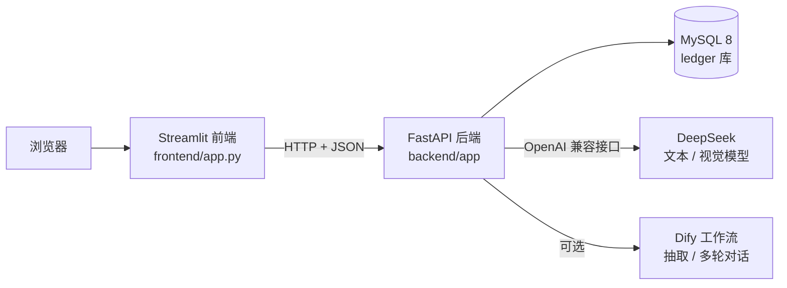

# AI 记账助手 · 方案设计文档

> 对应代码：`main` · 最后更新：2026-11-25
> 本文随功能迭代同步维护；与实现不一致时以代码为准，并回头修正本文。

## 1. 选题与场景

个人记账长期是"知道有用但坚持不下来"的场景：传统记账软件要求逐笔选分类、填金额，一笔消费要点五六次，几周后就没人再打开。而用户真正想知道的是"这个月吃饭花了多少""哪里超支了"这类问题，而不是流水本身。

本项目选择「个人记账与消费分析 AI 助手」作为题目，目标是把记账成本压到一句话或一张截图：

- 输入侧：自然语言（"午饭 25，和同事 AA"）、小票或支付截图
- 处理侧：大模型抽取金额、商户、时间、类别，结构化成账目
- 查询侧：用一句话提问，系统解析时间范围与类别后直接查库
- 提醒侧：按月设置总预算或分类预算，接近/超出时提示

**非目标**：不接入真实支付渠道，不涉及真实资金流转；不做多用户与权限体系；不做云端部署，定位是可在本机跑起来的完整演示应用。

## 2. 总体架构



- **前端**：Streamlit 单页应用，五个功能区（记账 / 查账 / 统计 / 预算 / 智能助手），所有数据通过后端接口读写，前端不保存业务数据。
- **后端**：FastAPI 提供 REST 接口，负责参数校验、业务编排、数据库读写与模型调用；启动时自动建库建表。
- **存储**：MySQL 8，原生 SQL，不使用 ORM。
- **AI 能力**：文本抽取、自然语言查账、小票识别走 OpenAI 兼容接口（默认 DeepSeek），也可切换到 Dify 工作流；多轮对话优先 Dify，其次 OpenAI 兼容，最后退回本地解析。

统一约定：

| 约定 | 内容 |
|---|---|
| 金额 | 数据库存 `DECIMAL(10,2)`（元），接口一律用整数「分」，换算只在存储层做 |
| 时间 | 入参必须带时区，存储为 naive UTC，读出时补回 UTC 时区 |
| 错误 | 所有非 2xx 统一 `{code, message, detail}` |
| 字段命名 | `snake_case` |

## 3. 模块划分

### 后端（`backend/app/`）

| 模块 | 职责 |
|---|---|
| `main.py` | 应用入口：lifespan 里初始化数据库、注册 CORS 与统一异常处理、挂载六个路由 |
| `api.py` | HTTP 层：Pydantic 请求/响应模型 + 全部路由（记账、查账、小票、统计、预算、助手） |
| `db.py` | 存储层：MySQL 连接、按请求注入连接、`init_db()` 建库建表补列、全部原生 SQL |
| `ai_client.py` | 模型调用：超时/重试/错误归类，OpenAI 兼容接口；模型输出字段清洗 |
| `ai_tasks.py` | 三类抽取任务：一句话记账、小票识别、查账意图解析；模型不可用时走规则兜底 |
| `ai_chat.py` | 多轮对话编排：Dify → OpenAI 兼容 → 本地解析 三级降级，会话落库 |
| `dify.py` | Dify 接入：任务工作流、文件上传、对话应用 |
| `error.py` | 统一错误结构与异常处理器 |

### 前端（`frontend/`）

| 文件 | 职责 |
|---|---|
| `app.py` | 页面入口与五个功能区（记账 / 查账 / 统计 / 预算 / 智能助手） |
| `.streamlit/config.toml` | 主题色、图表配色、上传大小等前端配置 |

## 4. 数据模型

共 6 张表，均由 `backend/schema.sql` 定义，应用启动时自动创建并补齐缺失的列与索引。

| 表 | 作用 | 关键字段 |
|---|---|---|
| `transactions` | 已确认的账目 | `amount`（元）、`merchant`、`category`、`occurred_at`、`source`、`note` |
| `transaction_drafts` | 解析出但未确认的草稿 | `draft_id`、各字段可空、`confidence`、`raw_text` |
| `budgets` | 月度预算 | `period`(YYYY-MM)、`category`、`amount`、`threshold` |
| `categories` | 类别与关键词 | `name`、`keywords`（规则兜底用） |
| `chat_sessions` | 对话会话 | `session_id`、`dify_conversation_id` |
| `chat_messages` | 对话消息 | `session_id`、`role`、`content` |

几个设计取舍：

- **金额**：数据库存 `DECIMAL(10,2)` 保证精确到分；接口层统一整数「分」，避免浮点误差在前后端之间传播。
- **时间**：数据库存 naive UTC，避免服务器时区变化导致数据漂移；展示与入参都用东八区，换算集中在一处。
- **草稿单独建表**：解析结果先落 `transaction_drafts`，用户确认后才写 `transactions`。这样"识别错了"不会污染账本，也方便统计识别准确率。
- **预算唯一键**：`period + category` 唯一，`category` 为空表示整月总预算；重复设置覆盖原值而不是新增行。

## 5. 关键流程

### 5.1 一句话记账 / 小票识别

```text
用户输入文本或上传图片
  → POST /transactions/parse 或 /receipts/parse
  → ai_tasks 调模型抽取（失败降级规则）
  → 返回草稿：金额、商户、类别、时间、missing_fields、engine
  → 前端展示可编辑预览表单，未识别字段标 ⚠️
  → 用户确认后 POST /transactions 落库
```

为什么要"草稿 → 确认"两步：模型输出不稳定，直接入库会把错误数据带进统计。确认环节把最终决定权交还用户，同时保留 `raw_text` 便于回溯。

### 5.2 自然语言查账

```text
用户提问："这个月吃饭花了多少"
  → POST /query/ask
  → 解析出 category=餐饮、date_from/date_to=本月、intent=total
  → 按条件查 transactions → 汇总金额与笔数
  → 返回 {answer, total_cents, count, items, engine}
```

关键点是**不让模型自由回答**：模型只负责把问题转成结构化查询条件，结果由 SQL 计算。这样答案可复现、可核对，也不会出现"编一个数字"。

### 5.3 预算与超支提醒

```text
GET /budgets?month=2026-11
  → 取当月总支出 + 各预算额度
  → 计算 ratio = spent / amount、status = normal / warning / exceeded
  → 前端用进度条与颜色区分（正常、接近上限、超支）
```

### 5.4 多轮助手

按可用性三级降级：Dify 对话应用（上下文交给 Dify）→ OpenAI 兼容接口（后端带历史消息）→ 本地单轮解析（至少把这句话解析成一笔草稿）。无论哪一级，记账写入仍走"草稿 → 确认"。

## 6. AI 能力与降级策略

- **文本模型与视觉模型分开配置**：DeepSeek 文本接口不带视觉能力，小票识别需要单独配置支持图片输入的服务；未配置视觉模型时返回空草稿，由用户手动补全。
- **未配置密钥不报错**：`engine=rule` / `local` 表示走了规则兜底，功能不中断，`GET /ai/status` 会列出缺失的配置项。
- **输出清洗**：模型返回的 JSON 统一校验金额范围、日期能否解析、类别是否在枚举内，不合格就走规则。
- **重试**：429 / 5xx / 超时按配置重试，仍失败则降级；错误统一成 `AiUnavailable`，接口层不感知具体供应商。
- **为什么要降级**：演示环境经常没有密钥或网络不稳，评审按文档跑时必须保证主流程可用。

## 7. 工程与协作

- **Git**：`main` 受保护，功能在 `feature/*` 分支开发，通过 Pull Request 合并；每个 PR 只做一件事，commit message 使用 `feat` / `fix` / `docs` / `style` 前缀。
- **依赖**：后端 `pip install`（Dockerfile 内固定），前端 `streamlit pandas altair requests`。
- **配置**：所有密钥走 `backend/.env`，仓库只提交 `.env.example`。
- **启动**：后端启动时自动建库建表；前端通过 `API_URL` 环境变量指定后端地址。

## 8. 遇到的问题与未完成部分

### 已解决

- **模型输出不稳定**：同一句话可能返回不同结构 → 加 Pydantic 校验与字段清洗，不合格降级规则。
- **视觉模型不可用**：DeepSeek 文本接口不支持图片 → 视觉模型独立配置，失败时返回空草稿而不是报错。
- **前端指标截断**：4 列指标在窄屏显示不全 → 改为 3 列 + 说明行。
- **删除只删前端**：早期版本删除只改列表 → 改为调用 `DELETE /transactions/{id}` 并加二次确认。

### 未完成

| 事项 | 原因 | 后续计划 |
|---|---|---|
| Docker 一键编排 | 需要同时编排 MySQL、后端、前端三个容器，时间不足 | 提供 `docker-compose.yml` 与数据卷说明 |
| 批量删除与撤销 | 优先级低于核心链路 | 前端多选 + 软删除 |
| 自动化测试 | 目前只有手工测试报告与 `check_ai.py` 自检 | 补 pytest 覆盖四类接口 |
| 视觉模型识别率 | 缺少真实小票样本 | 收集样本后评估并调整提示词 |

## 9. 小结

项目把"自然语言/图片 → 结构化账目 → 统计与查询"的链路完整打通，并在模型不可用时保持可用；工程上保持前后端分离、配置与密钥隔离、错误响应统一。当前主要缺口集中在部署编排（Docker）与测试自动化上。
